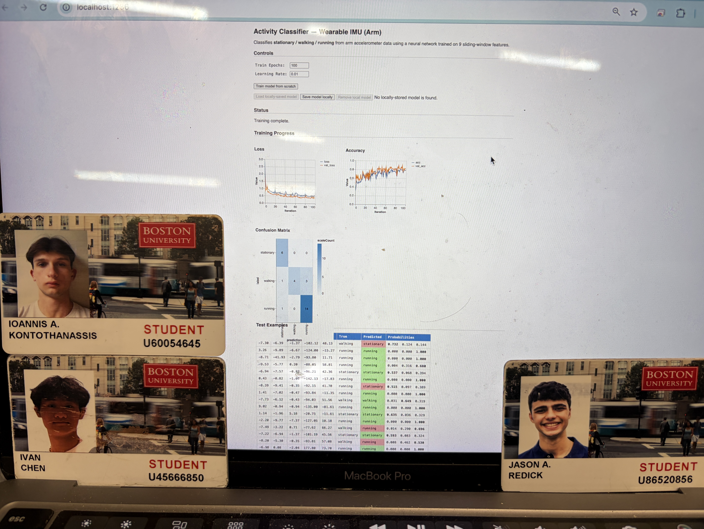

# From Motion to Meaning

Authors: Jason Redick, Alexios Kontothanassis, Ivan Chen

Date: 2026-04-13

### Summary
Our group learned to bridge the gap between raw hardware signals and high-level behavioral analysis by building a complete end-to-end IoT pipeline. We gained hands-on experience configuring a Raspberry Pi as a headless Node.js server and establishing low-latency data streams from an ESP32 over UDP, which proved essential for capturing the rapid motion of an IMU in real time. Beyond the networking, we learned the importance of data engineering—specifically how to collect and label datasets to train a machine learning model that could accurately distinguish between stationary, walking, and irregular movements. The investigative component was especially eye-opening for us, as it demonstrated that physical factors like sensor placement and mounting orientation are just as critical to classification accuracy as the software logic itself. Concluding this quest gave our team a practical understanding of how to transform noisy, real-world sensor data into a stable, live-updating dashboard for meaningful human activity recognition.

### Solution Design

To build our solution, we designed a cyber-physical pipeline that integrates a wearable hardware node with a centralized software server. On the hardware side, we interfaced an ESP32 with an MPU6050 IMU via I2C to capture real-time motion data, mounting the device on the ankle to maximize the distinctiveness of gait patterns. The data flow begins with the ESP32 sampling accelerometer and gyroscope axes and transmitting raw readings as JSON packets over UDP to a Raspberry Pi Node.js server to ensure minimal latency. The software architecture utilizes a dual-path approach: the server logs incoming streams to a CSV for dataset curation while simultaneously pushing live data to a web dashboard via WebSockets. The control flow is managed by a state machine on the ESP32 that handles WiFi connectivity and continuous streaming, paired with a TensorFlow.js inference engine on the frontend that classifies activities—stationary, walking, running, or turning—in real time. Finally, we visualized these signals using CanvasJS, providing a live feedback loop that displays both the raw waveforms and the model's classification confidence.

### Quest Summary
We found that the real-time predictions were highly inaccurate despite our initial training efforts. Specifically, the model struggled with significant misclassifications: when a user was completely stationary, the dashboard would frequently register the activity as "walking," and it rarely ever successfully classified the "running" state. We suspect these failures occurred because the model overfit to our limited training dataset and struggled to parse the amplitude thresholds and noisy artifacts of live human motion. If we were to repeat this quest, we would focus on improving the model's real-world generalization by collecting a much larger, more diverse ground-truth dataset using the MoCap system. Additionally, we would optimize our sliding window size and apply stronger low-pass filtering to the UDP stream to eliminate the minor baseline sensor noise that caused standing to be read as active movement.

### Supporting Artifacts
- [Link to video technical presentation](https://drive.google.com/file/d/1xLcr6-4a8_7tLIEeNShtUUjYCZFw6-69/view?usp=drive_link). Not to exceed 120s
- [Link to video demo](https://drive.google.com/file/d/17vkYy2PY7bbkB22qBf2SarPniYoA5KkR/view?usp=sharing). Not to exceed 120s

### Investigative Question
How does sensor placement and motion variability affect activity recognition performance? Compare at least two mounting locations or motion styles and explain the observed differences.

Where you place the sensor changes how well the tracker works in the real world. Our arm sensor reached 80% accuracy in training because the movements were clear. However, it failed in live testing because people move their arms randomly (like when talking), which confused the model. On the other hand, the leg sensor only hit 60% training accuracy because heavy footsteps create messy, noisy data that our model struggled to read. Even though leg data is noisier, it is much better for tracking movement because legs are only used for getting around, not random gestures. Ultimately, arm sensors give clear data but cause too many false alarms, while leg sensors give messy data that truly matches the activity and just needs better filtering to work well.

### Self-Assessment 

| Objective Criterion | Rating | Max Value  | 
|---------------------------------------------|:-----------:|:---------:|
| Objective One | 1 |  1     | 
| Objective Two | 1 |  1     | 
| Objective Three | 1 |  1     | 
| Objective Four | 1 |  1     | 
| Objective Five | 1 |  1     | 
| Objective Six | 1 |  1     | 
| Objective Seven | 1 |  1     | 

### AI and Open Source Code Assertions

- We have documented in our code readme.md and in our code any software that we have adopted from elsewhere
- We used AI for coding and this is documented in our code as indicated by comments "AI generated" 

