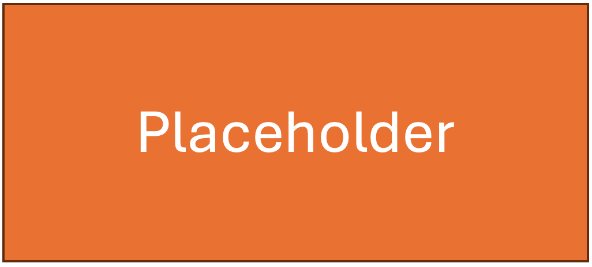

#  Sensor Fusion Localization

Authors: Jason Redick, Alexios Kontothanassis, Ivan Chen Date: 2026-03-05

### Summary

In this quest, I transformed raw analog signals into a real-time localization system by integrating an accelerometer, LiDAR, and ultrasonic sensor with an ESP32. My primary goal was to "bring up" these sensors—mapping their power requirements, setting up ADC channels with appropriate voltage dividers, and writing a modular codebase to convert raw bits into engineering units like meters and m/s^2
 . To move from raw data to a "green path" trajectory, I developed a data pipeline that streamed measurements to a Node.js host for live visualization using CanvasJS.

To make the system functional and accurate, I had to overcome the inherent noise of analog sensors and the drift associated with double-integrating accelerometer data. I achieved this by implementing two filtering strategies—a threshold-based filter to eliminate low-level vibrations and a temporal moving average to stabilize distance readings. I then applied a basic sensor fusion strategy, using the absolute distance measurements from the LiDAR to "correct" the drifting accelerometer estimate. Finally, I benchmarked my DIY system against smartphone IMU data to quantify my error levels and validated the entire setup through a real-time graphical dashboard.
### Solution Design

Describe how you built your solution. Use hardware and software
diagrams, show data flow, include control flow or state charts if
appropriate.

Template for Including Graphics

### Quest Summary
Summarize your results and call out any challenges or things you would
have done differently.

### Supporting Artifacts
- [Link to video technical presentation](). Not to exceed 120s
- [Link to video demo](). Not to exceed 120s

### Self-Assessment 

| Objective Criterion | Rating | Max Value  | 
|---------------------------------------------|:-----------:|:---------:|
| Objective One | 1 |  1     | 
| Objective Two | 1 |  1     | 
| Objective Three | 1 |  1     | 
| Objective Four | 1 |  1     | 
| Objective Five | 1 |  1     | 
| Objective Six | 1 |  1     | 
| Objective Seven | 1 |  1     | 

### AI and Open Source Code Assertions

- We have documented in our code readme.md and in our code any software that we have adopted from elsewhere
- We used AI for coding and this is documented in our code as indicated by comments "AI generated" 

