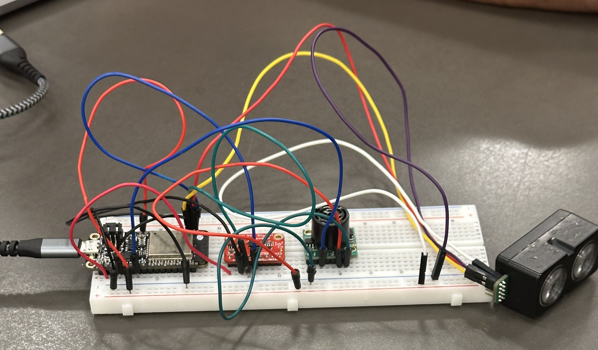

#  Sensor Fusion Localization

Authors: Jason Redick, Alexios Kontothanassis, Ivan Chen Date: 2026-03-05

### Summary

In this quest, I transformed raw analog signals into a real-time localization system by integrating an accelerometer, LiDAR, and ultrasonic sensor with an ESP32. My primary goal was to "bring up" these sensors—mapping their power requirements, setting up ADC channels with appropriate voltage dividers, and writing a modular codebase to convert raw bits into engineering units like meters and m/s^2
 .To move from raw data to a "green path" trajectory, I developed a data pipeline that streamed measurements to a Node.js host for live visualization using CanvasJS.

To make the system functional and accurate, I had to overcome the inherent noise of analog sensors and the drift associated with double-integrating accelerometer data. I achieved this by implementing two filtering strategies—a threshold-based filter to eliminate low-level vibrations and a temporal moving average to stabilize distance readings. I then applied a basic sensor fusion strategy, using the absolute distance measurements from the LiDAR to "correct" the drifting accelerometer estimate. Finally, I benchmarked my DIY system against smartphone IMU data to quantify my error levels and validated the entire setup through a real-time graphical dashboard.
### Solution Design

Our project tracks a person's forward walking in real time and shows it on a screen. We built this using an ESP32 microcontroller as the main control unit. Connected to the microcontroller are two sensors: a LiDAR sensor that measures the actual distance to the wall or object in front of it, and an accelerometer that detects the movement and speed of the person's steps. To make sure both sensors have enough power to work properly, we wired them directly to the ESP32's 5V USB power pin.

For the wiring, we connected both the LiDAR and the accelerometer to the exact same two communication pins on the ESP32, called the SDA and SCL pins. We can share these pins because the sensors use a communication method called I2C. You can think of I2C like a teacher calling on students in a classroom. Every sensor has a unique address built into it—for example, the accelerometer is 0x53 and the LiDAR is 0x62. When the ESP32 wants information, it calls out a specific address over the wire. Only the sensor with that matching address answers, while the other sensor stays quiet. This prevents their data streams from colliding.

For the programming, the ESP32 uses a system called FreeRTOS, which lets it multitask and read both sensors at the exact same time. The raw data that comes from the accelerometer is normally very jumpy and noisy just from normal physical vibrations. To fix this, we put the data through two filtering steps before we use it:

A smoothing filter (Low-Pass Filter): This averages out the quick, random electrical spikes so the data line is smoother.

A threshold filter (Deadband): This ignores tiny, meaningless shakes when the sensor is supposed to be standing still.

Once the accelerometer data is clean, we use a math calculation called double integration. This simply means we use the acceleration to calculate how fast the device is moving, and then use that new speed value to figure out how far it has traveled.

Finally, the ESP32 takes the measured distance from the LiDAR and the calculated position from the accelerometer and sends them through a USB cable to a laptop. On the laptop, a background program written in Node.js catches all this incoming data. It then passes the data to a web charting tool called CanvasJS, which automatically draws a live, moving graph on the screen. This setup allows us to watch a live representation of the person walking and compare the two sensors side-by-side.

Lidarv4 and Accelerometer wired together to ESP32 same SCL and SDA pin

### Quest Summary
Summarize your results and call out any challenges or things you would
have done differently.

### Supporting Artifacts
- [Link to video technical presentation](). Not to exceed 120s
- [Link to video demo](https://drive.google.com/file/d/1nhvY1g3gkUNpFocvj2V990glKWTwxV2_/view?usp=drive_link).

## Investigative question: Do you observe any patterns in the noise? How could you improve localization under the noisier scenarios? 

The most obvious pattern in the accelerometer data is how quickly the position calculation drifts away from reality. Because the data is double-integrated, even a microscopic constant error in the acceleration reading becomes a growing error in velocity, which then becomes a massive, curving error in position over time.
Because velocity error compounds over time, we need a way to reset it. We could upgrade our code to detect when a step is finished and the device is momentarily still (using our deadband threshold). The moment the device registers as "still," the software should forcefully reset the calculated velocity back to exactly zero. This breaks the snowball effect of integration drift.
### Self-Assessment 
| Objective Criterion | Rating | Max Value  | 
|---------------------------------------------|:-----------:|:---------:|
| Objective One | 1 |  1     | 
| Objective Two | 1 |  1     | 
| Objective Three | 1 |  1     | 
| Objective Four | 1 |  1     | 
| Objective Five | 1 |  1     | 
| Objective Six | 1 |  1     | 
| Objective Seven | 1 |  1     | 

### AI and Open Source Code Assertions

- We have documented in our code readme.md and in our code any software that we have adopted from elsewhere
- We used AI for coding and this is documented in our code as indicated by comments "AI generated" 

