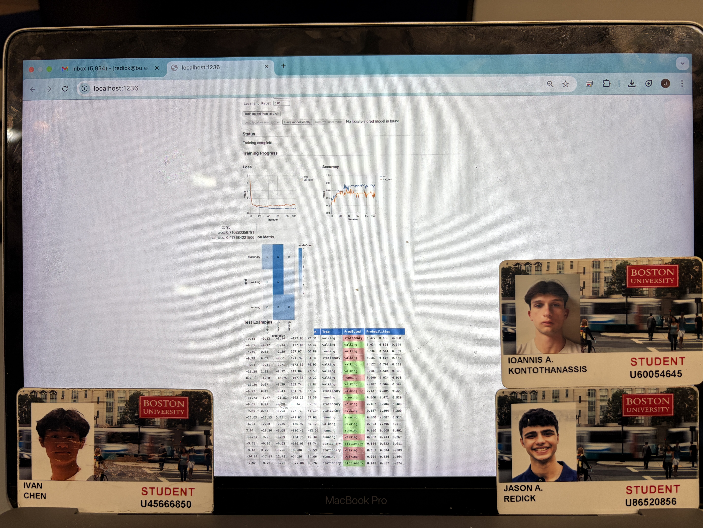

#From Motion to Meaning

Authors: Jason Redick, Alexios Kontothanassis, Ivan Chen

Date: 2026-04-13

### Summary
Our group learned to bridge the gap between raw hardware signals and high-level behavioral analysis by building a complete end-to-end IoT pipeline. We gained hands-on experience configuring a Raspberry Pi as a headless Node.js server and establishing low-latency data streams from an ESP32 over UDP, which proved essential for capturing the rapid motion of an IMU in real time. Beyond the networking, we learned the importance of data engineering—specifically how to collect and label datasets to train a machine learning model that could accurately distinguish between stationary, walking, and irregular movements. The investigative component was especially eye-opening for us, as it demonstrated that physical factors like sensor placement and mounting orientation are just as critical to classification accuracy as the software logic itself. Concluding this quest gave our team a practical understanding of how to transform noisy, real-world sensor data into a stable, live-updating dashboard for meaningful human activity recognition.

### Solution Design

To build our solution, we designed a cyber-physical pipeline that integrates a wearable hardware node with a centralized software server. On the hardware side, we interfaced an ESP32 with an MPU6050 IMU via I2C to capture real-time motion data, mounting the device on the ankle to maximize the distinctiveness of gait patterns. The data flow begins with the ESP32 sampling accelerometer and gyroscope axes and transmitting raw readings as JSON packets over UDP to a Raspberry Pi Node.js server to ensure minimal latency. The software architecture utilizes a dual-path approach: the server logs incoming streams to a CSV for dataset curation while simultaneously pushing live data to a web dashboard via WebSockets. The control flow is managed by a state machine on the ESP32 that handles WiFi connectivity and continuous streaming, paired with a TensorFlow.js inference engine on the frontend that classifies activities—stationary, walking, running, or turning—in real time. Finally, we visualized these signals using CanvasJS, providing a live feedback loop that displays both the raw waveforms and the model's classification confidence.

### Quest Summary
We found that sensor placement significantly impacted our model's initial performance: arm-mounted data achieved 80% training accuracy, while leg data reached only 60%. However, during live testing with the arm-mounted sensor, the real-time predictions proved highly inaccurate. We suspect this failure was due to the model either overfitting to our specific training dataset or underfitting the natural variance of live human motion. Additionally, the leg data presented its own challenges, containing complex, overlapping motion artifacts during transitional movements. If we were to repeat this quest, we would focus on improving our model's real-world generalization by collecting a much larger, more diverse ground-truth dataset using the MoCap system, optimizing our sliding window size, and applying stronger signal filtering to the UDP stream.

### Supporting Artifacts
- [Link to video technical presentation](). Not to exceed 120s
- [Link to video demo](). Not to exceed 120s

###Investigative Question
How does sensor placement and motion variability affect activity recognition performance? Compare at least two mounting locations or motion styles and explain the observed differences.

### Self-Assessment 

| Objective Criterion | Rating | Max Value  | 
|---------------------------------------------|:-----------:|:---------:|
| Objective One | 1 |  1     | 
| Objective Two | 1 |  1     | 
| Objective Three | 1 |  1     | 
| Objective Four | 1 |  1     | 
| Objective Five | 1 |  1     | 
| Objective Six | 1 |  1     | 
| Objective Seven | 1 |  1     | 

### AI and Open Source Code Assertions

- We have documented in our code readme.md and in our code any software that we have adopted from elsewhere
- We used AI for coding and this is documented in our code as indicated by comments "AI generated" 

